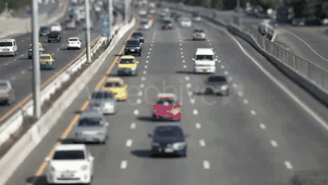

# Metric Vehicle Speed Estimation from Monocular Video
**RAFT optical flow + YOLOv8-seg/ByteTrack + ground-plane homography -> per-vehicle km/h**

Anushka Gupta (24UEC123) and Parul Bangar (24UEC256) · Instructor: Dr. Abhishek Grover · LNMIIT Jaipur, Computer Vision term paper

RAFT (Teed & Deng, ECCV 2020; https://github.com/princeton-vl/RAFT, torchvision port used here) outputs pixel motion only.
This project adds: (1) per-vehicle segmentation masks and tracking, (2) a 4-point homography that maps pixels to ground-plane metres,
(3) median flow over each vehicle's road-contact region (bottom 25% of its mask) converted to km/h, (4) validation: cross-method agreement plus a synthetic known-speed check (real known-speed validation pending).

## Pipeline
video -> YOLOv8-seg + ByteTrack (vehicle masks, IDs) -> RAFT flow (t vs t-gap) -> homography H (calibrate.py) -> median ground displacement -> x fps / gap x 3.6 -> km/h

## Setup (Python 3.12 recommended)
    python -m venv .venv && .venv\Scripts\activate
    pip install -r requirements.txt

## Run
    python calibrate.py clip.mp4 --width-m <W> --length-m <L>         # click 4 road points: near-left, near-right, far-right, far-left
    python speed_estimator.py clip.mp4 --flow raft_large --out res_raftL
    python speed_estimator.py clip.mp4 --flow farneback  --out res_farneback   # classical baseline
    python speed_estimator.py clip.mp4 --flow track      --out res_track       # tracking-only reference (no flow)
    python list_tracks.py res_raftL.csv                               # map recorded passes to track ids -> write gt.csv (track_id,gt_kmh)
    python compare.py gt.csv res_raftL.csv res_farneback.csv res_track.csv     # MAE / bias / RMSE / r table + plot
    python benchmark.py clip.mp4 gt.csv [--quick]                     # ablations: flow model, gap, resolution, mask erosion, percentile
    python make_assets.py res_raftL.mp4 res_farneback.mp4 res_track.mp4        # screenshots, GIFs, side-by-side image
python synthetic_test.py                                          # synthetic known-speed check of geometry + formula
jupyter notebook demo.ipynb                                       # step-by-step demo: calibration preview, run, compare

## Results
**A. Cross-method agreement (stock highway clip, no ground truth, 21 vehicles seen by all methods; reference = tracking-only):**

| Method | r vs tracking | Bias (km/h) | MAE (km/h) | RMSE (km/h) | MAPE (%) |
|---|---|---|---|---|---|
| RAFT-small | 0.54 | -5.6 | 5.7 | 7.3 | 13.9 |
| **RAFT-large** | **0.92** | +1.8 | **2.2** | 2.8 | 5.2 |
| Farneback | 0.83 | +9.5 | 9.7 | 10.5 | 23.7 |

Tracking-only is a reference method, not ground truth.

**B. Synthetic ground-truth check** (`python synthetic_test.py`): a flat textured vehicle moves at a known speed through a known camera homography; km/h is recovered with the same `vehicle_speed()` as the pipeline.

| True (km/h) | A: exact flow | B: Farneback flow | B: Farneback + mask erosion 3 |
|---|---|---|---|
| 10 | 10.0 | 9.4 | 9.5 |
| 20 | 20.0 | 18.7 | 18.9 |
| 30 | 30.0 | 28.8 | 29.2 |
| 40 | 40.0 | 38.0 | 38.8 |
| 50 | 50.0 | 46.6 | 48.2 |
| 60 | 60.0 | 40.4 | 44.3 |
| 80 | 80.0 | 10.8 | 11.3 |
| 100 | 100.0 | 11.4 | 11.7 |

- Test A (exact flow field) recovers every speed with 0.00 km/h error, so the homography, formula and units are correct.
- Test B (Farneback flow) underestimates slightly up to 50 km/h; motion at 60 km/h and above is beyond its range in this setup. Mask erosion (`--erode 3`) reduces the low-speed bias.
- A 10% error in the entered road length gives exactly a 10% speed error (50 km/h is read as 55).
- Limits: planar synthetic scene, no detector, tracker, RAFT or real-world noise.

**C. Known-speed real clip:** not yet run (protocol in `RECORD_GUIDE.md`).

## Limitations
Fixed camera; planar road assumption; manual 4-point calibration (absolute km/h depends on the real distances entered); blurred or tilt-shift footage degrades flow; CPU RAFT-large is slow.

## References
Teed & Deng, RAFT (ECCV 2020) | Jocher et al., Ultralytics YOLOv8 | Zhang et al., ByteTrack (ECCV 2022) | Sochor et al., BrnoCompSpeed (IEEE T-ITS 2019).